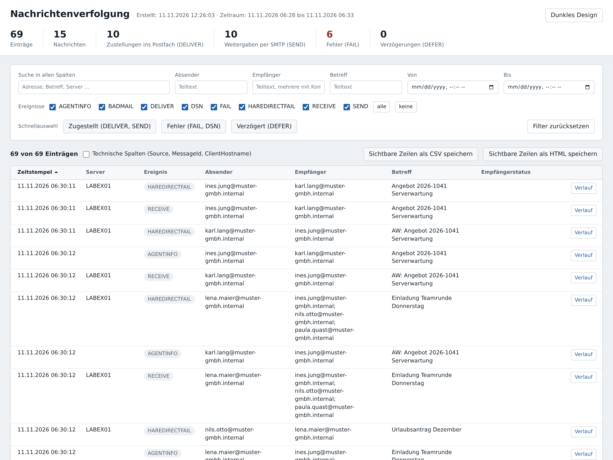
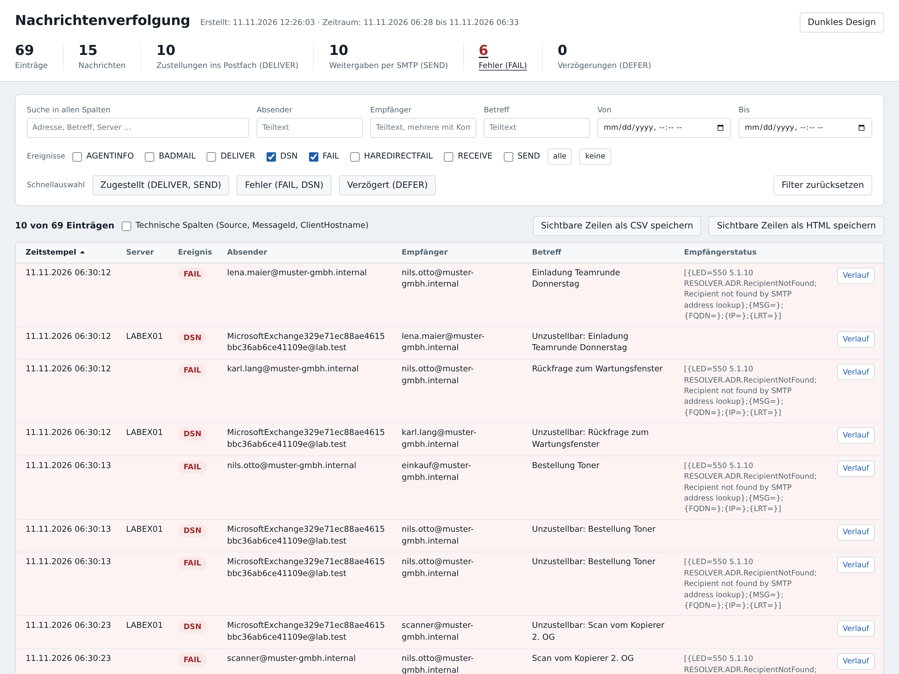
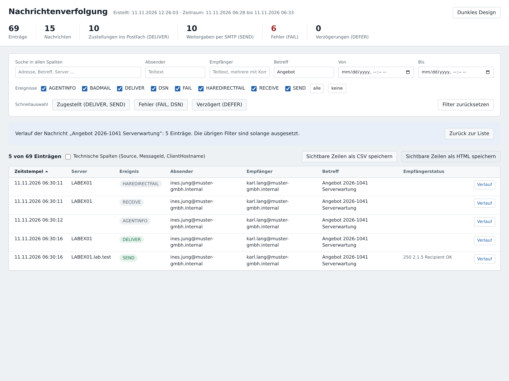
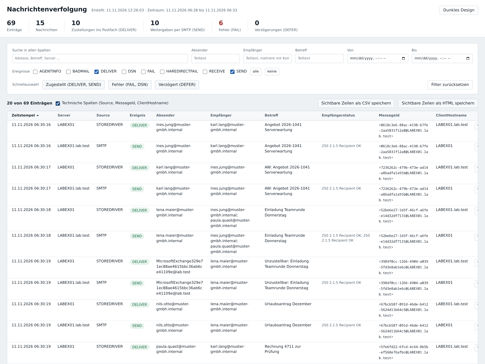
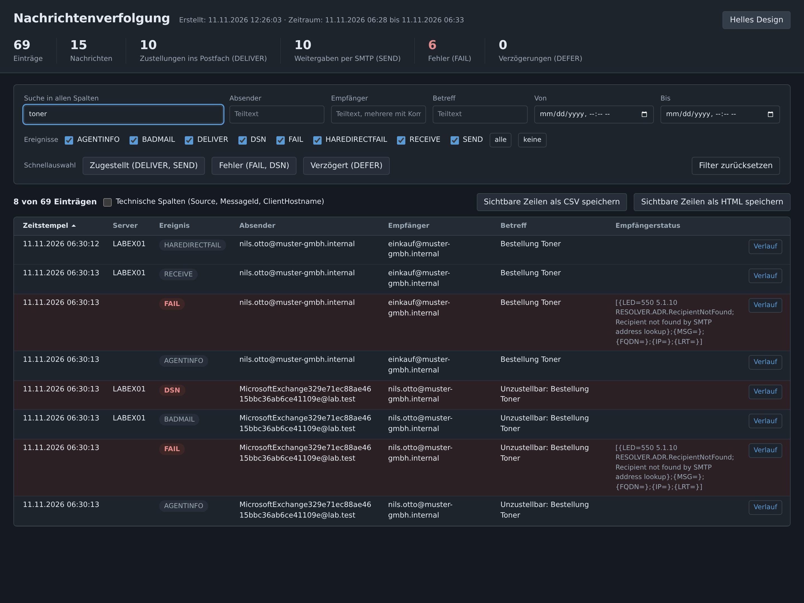

# Exchange-Nachrichtenverfolgung – Message Tracking in Exchange Server durchsuchen

PowerShell-Skript für **Exchange Server (lokal installiert)**: durchsucht die Nachrichtenverfolgung (Message Tracking) aller Transport-Server und beantwortet die Frage „Ist die Mail angekommen?“. Ein Assistent in der Konsole fragt Zeitraum, Absender, Empfänger, Betreff und Ereignisse ab; das Ergebnis erscheint als **HTML-Bericht auf Deutsch oder Englisch** (`-Language de|en`, Standard je nach Windows-Sprache) und lässt sich als CSV speichern. Das Skript arbeitet **ausschließlich lesend**.

**Dieses Verzeichnis enthält kein Skript, nur Bilder der Funktionen.** Das Skript lässt sich nicht sinnvoll in eine gekürzte kostenlose Fassung teilen. Die Vollversion gibt es hier:

➜ **[Vollversion auf Gumroad](https://mueller86.gumroad.com/l/msria)** · **[Vollversion auf Etsy](https://www.etsy.com/listing/4614785975)** · **[alle Skripte im Shop](https://www.etsy.com/shop/ITAdminToolsbyMM)**

Alle Bilder stammen aus einer Testumgebung mit erfundenen Postfächern.

## Übersicht

Kennzahlen im Kopf (Einträge, Nachrichten, Zustellungen, Weitergaben, Fehler, Verzögerungen), Filter und alle Einträge der Suche.

## Nur die Fehler

Ein Klick auf die Kennzahl oder die Schnellauswahl zeigt nur fehlgeschlagene Zustellungen (FAIL, DSN) mit dem Grund aus dem Empfängerstatus.

## Verlauf einer Nachricht

„Verlauf“ zeigt alle Einträge zu genau einer Mail – vom Eingang bis zur Zustellung.

## Technische Spalten auf Wunsch

Source, MessageId und ClientHostname lassen sich einblenden. Die CSV enthält immer alle Spalten.

## Helles und dunkles Design

## Eckdaten

- Windows PowerShell 5.1, Exchange Server 2013, 2016, 2019 oder SE (lokal installiert, nicht Exchange Online)
- Konto mit einer Rolle, die `Get-MessageTrackingLog` erlaubt, z. B. „View-Only Organization Management“
- Zeigt je Transport-Server, wie weit die Logs zurückreichen
- Getestet mit Exchange Server SE unter Windows Server 2025 in einer Testumgebung mit einem Exchange-Server; nicht getestet mit Exchange 2013/2016/2019 und mehreren Transport-Servern
- Der Bericht ist eine einzelne HTML-Datei ohne Nachladen aus dem Internet

## Weitere Skripte

- [Exchange-Kalenderrechte](https://github.com/jackyno7/exchange-kalenderrechte) (Bilder der Funktionen)
- [AD-Schnellcheck](https://github.com/jackyno7/ad-schnellcheck) (kostenlos, 8 Prüfpunkte zur Domäne)

<!-- querverweis:anfang -->
## Alle Skripte und Vorlagen

Übersicht aller Prüfskripte und Vorlagen: **[github.com/jackyno7](https://github.com/jackyno7)**

Vollversionen:

- Active Directory Prüfbericht: [Etsy](https://www.etsy.com/listing/4588853943) · [Gumroad](https://mueller86.gumroad.com/l/fcneoc)
- Domänencontroller-Gesundheitsbericht: [Etsy](https://www.etsy.com/listing/4593087246) · [Gumroad](https://mueller86.gumroad.com/l/bseljr)
- DNS- und DHCP-Bericht: [Etsy](https://www.etsy.com/listing/4593096270) · [Gumroad](https://mueller86.gumroad.com/l/sthgh)
- Kerberos- und Altlasten-Check: [Etsy](https://www.etsy.com/listing/4593092377) · [Gumroad](https://mueller86.gumroad.com/l/zptvct)
- Berechtigungsbericht Active Directory: [Etsy](https://www.etsy.com/listing/4593113568) · [Gumroad](https://mueller86.gumroad.com/l/xyjmdr)
- GPO-Bericht: [Etsy](https://www.etsy.com/listing/4593129111) · [Gumroad](https://mueller86.gumroad.com/l/wdosl)
- Anmelde- und Sperrbericht: [Etsy](https://www.etsy.com/listing/4593157082) · [Gumroad](https://mueller86.gumroad.com/l/ztktaaq)
- Rechner-Inventar aus Active Directory: [Etsy](https://www.etsy.com/listing/4593088535) · [Gumroad](https://mueller86.gumroad.com/l/zzycdd)
- Dateiserver-Bericht: [Etsy](https://www.etsy.com/listing/4612420692) · [Gumroad](https://mueller86.gumroad.com/l/wbbwj)
- Dateiserver-Rechte-Bericht: [Etsy](https://www.etsy.com/listing/4616706194) · [Gumroad](https://mueller86.gumroad.com/l/ijrkb)
- Windows-Rechnerbericht: [Etsy](https://www.etsy.com/listing/4616020701) · [Gumroad](https://mueller86.gumroad.com/l/wmhfk)
- Exchange-Postfachbericht: [Etsy](https://www.etsy.com/listing/4614916333) · [Gumroad](https://mueller86.gumroad.com/l/gkdllj)
- Exchange-Kalenderrechte-Bericht: [Etsy](https://www.etsy.com/listing/4614799790) · [Gumroad](https://mueller86.gumroad.com/l/iabfb)
- Exchange-Nachrichtenverfolgung: [Etsy](https://www.etsy.com/listing/4614785975) · [Gumroad](https://mueller86.gumroad.com/l/msria)
- Active Directory Prüfskript-Paket: [Etsy](https://www.etsy.com/listing/4611942401) · [Gumroad](https://mueller86.gumroad.com/l/awzjtc)

Vorlagen und Checklisten (Notfallplan, Backup, Passwortrichtlinie, Onboarding, Homeoffice, Netzwerk-Dokumentation): [Etsy](https://www.etsy.com/shop/ITAdminToolsbyMM) · [Gumroad](https://mueller86.gumroad.com)
<!-- querverweis:ende -->

## Hinweise

- Der Bericht enthält Absender, Empfänger und Betreffzeilen, also personenbezogene Daten. Einsatz vorab im Unternehmen klären.
- Bei der Ausarbeitung wurden KI-Werkzeuge unterstützend eingesetzt; Inhalte und Skript wurden fachlich geprüft und im Testlab getestet.

---

### English

Screenshots of a read-only PowerShell script for on-premises Exchange Server that searches the message tracking logs of all transport servers and shows the result as a filterable HTML report in German or English (`-Language de|en`) with CSV export. This repository contains screenshots only. Full version: https://mueller86.gumroad.com/l/msria

<!-- querverweis-en:anfang -->
#### All scripts and templates

Overview of all check scripts and templates: **[github.com/jackyno7](https://github.com/jackyno7)**

Full versions:

- Active Directory Audit Report: [Etsy](https://www.etsy.com/listing/4588853943) · [Gumroad](https://mueller86.gumroad.com/l/fcneoc)
- Domain Controller Health Report: [Etsy](https://www.etsy.com/listing/4593087246) · [Gumroad](https://mueller86.gumroad.com/l/bseljr)
- DNS and DHCP Report: [Etsy](https://www.etsy.com/listing/4593096270) · [Gumroad](https://mueller86.gumroad.com/l/sthgh)
- Kerberos and Legacy Check: [Etsy](https://www.etsy.com/listing/4593092377) · [Gumroad](https://mueller86.gumroad.com/l/zptvct)
- Active Directory Permissions Report: [Etsy](https://www.etsy.com/listing/4593113568) · [Gumroad](https://mueller86.gumroad.com/l/xyjmdr)
- GPO Report: [Etsy](https://www.etsy.com/listing/4593129111) · [Gumroad](https://mueller86.gumroad.com/l/wdosl)
- Logon and Lockout Report: [Etsy](https://www.etsy.com/listing/4593157082) · [Gumroad](https://mueller86.gumroad.com/l/ztktaaq)
- Computer Inventory from Active Directory: [Etsy](https://www.etsy.com/listing/4593088535) · [Gumroad](https://mueller86.gumroad.com/l/zzycdd)
- File Server Report: [Etsy](https://www.etsy.com/listing/4612420692) · [Gumroad](https://mueller86.gumroad.com/l/wbbwj)
- File Server Permissions Report: [Etsy](https://www.etsy.com/listing/4616706194) · [Gumroad](https://mueller86.gumroad.com/l/ijrkb)
- Windows Computer Report: [Etsy](https://www.etsy.com/listing/4616020701) · [Gumroad](https://mueller86.gumroad.com/l/wmhfk)
- Exchange Mailbox Report: [Etsy](https://www.etsy.com/listing/4614916333) · [Gumroad](https://mueller86.gumroad.com/l/gkdllj)
- Exchange Calendar Permissions Report: [Etsy](https://www.etsy.com/listing/4614799790) · [Gumroad](https://mueller86.gumroad.com/l/iabfb)
- Exchange Message Tracking: [Etsy](https://www.etsy.com/listing/4614785975) · [Gumroad](https://mueller86.gumroad.com/l/msria)
- Active Directory Check Script Bundle: [Etsy](https://www.etsy.com/listing/4611942401) · [Gumroad](https://mueller86.gumroad.com/l/awzjtc)

Templates and checklists (emergency plan, backup, password policy, onboarding, home office, network documentation): [Etsy](https://www.etsy.com/shop/ITAdminToolsbyMM) · [Gumroad](https://mueller86.gumroad.com)
<!-- querverweis-en:ende -->
